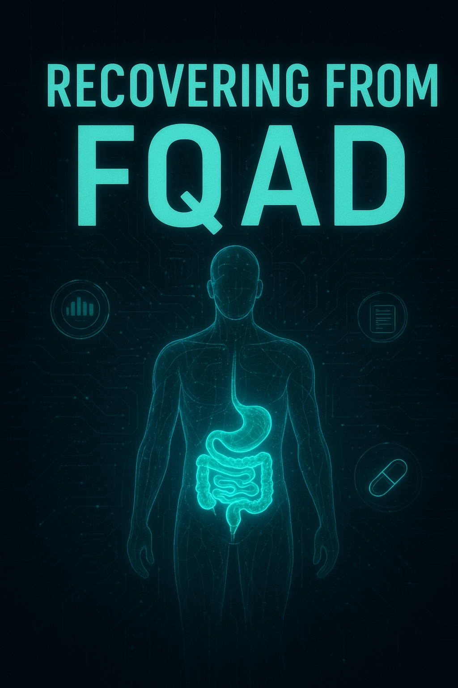

# Recovering from Fluoroquinolone-Associated Disability (FQAD)

This book provides a science-based guide to understanding and recovering from Fluoroquinolone-Associated Disability (FQAD), a multisystem condition triggered by fluoroquinolone antibiotics (e.g., ciprofloxacin, levofloxacin, moxifloxacin). It draws on established mechanisms like mitochondrial dysfunction, oxidative stress, ion chelation, and collagen degradation, while emphasizing evidence-informed recovery strategies. The structure progresses from education and diagnosis to practical recovery protocols, supported by patient experiences and emerging research. The tone is empathetic, hopeful, and cautious—no cures are promised, but gradual improvement is possible through targeted interventions.

## Chapters

1. Introduction to FQAD
2. The Science of Fluoroquinolone Toxicity
3. Mitochondrial Dysfunction and Oxidative Stress
4. Musculoskeletal and Connective Tissue Damage
5. Neurological and Neuropsychiatric Effects
6. Other Systems and Multisystem Nature
7. Diagnosis and Differential Diagnosis
8. Risk Factors and Prevention
9. Principles of Recovery
10. Nutritional and Supplement Strategies
11. Lifestyle and Therapeutic Interventions
12. Patient Stories and Recovery Trajectories
13. Emerging Research and Future Directions
14. Conclusion and Resources

## Prompts

- We are going to write a book about recovering from FQAD. Plan all the chapters based on all the science you know in plan.md. (Grok)
- Write each chapter in its own Markdown file following plan.md. (Grok)
- Review chapter 1 to 14. Correct each chapter with all the science facts you know for sure and go in depth as much as you can. (Gemini)
